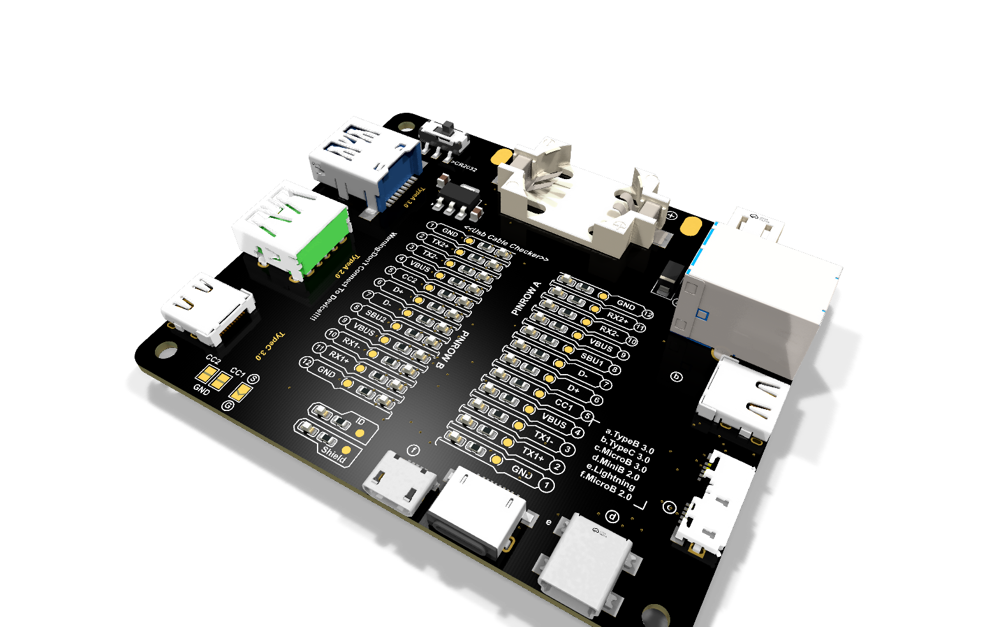
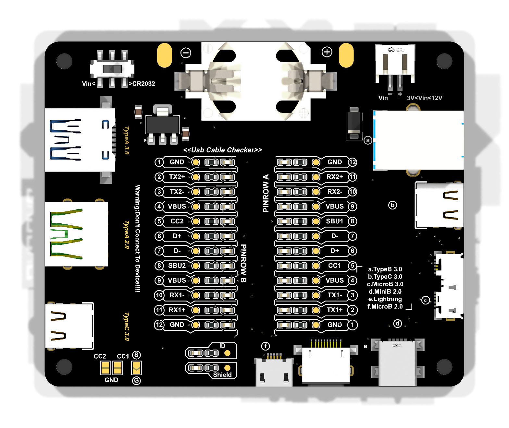
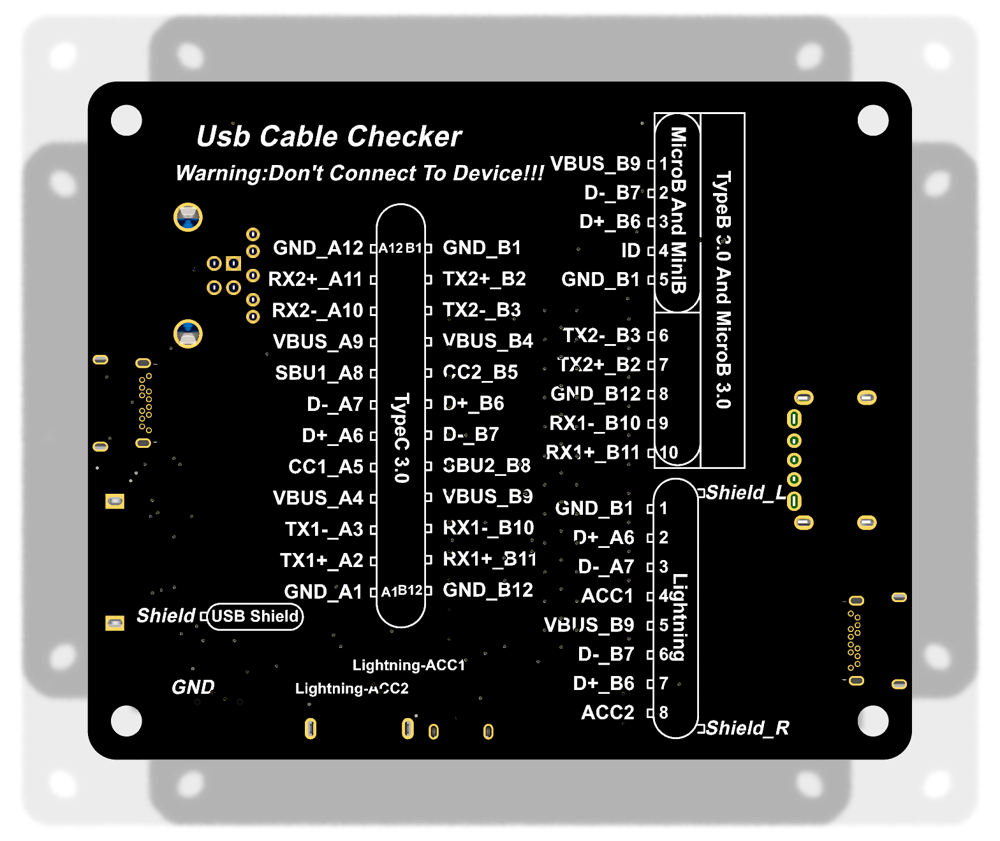

<!-- boardrepo-badge:v1 -->

<!-- /boardrepo-badge:v1 -->

# USB Cable Checker

A passive continuity tester for USB cables, designed in KiCad 10.

Plug one end of a cable into a **source** connector and the other end into a
**sink** connector. Each conductor present in the cable lights its own LED, so
you can see at a glance whether a cable is charge-only, USB 2.0, or fully wired
for USB 3.x, and spot broken or missing wires.

> [!WARNING]
> Never plug the checker into a real device, host or charger. Every contact on
> the source side, including GND and shield, sits at the test voltage.

## How it works

- **Source side (J1–J3):** every contact is tied to the test voltage, `VTEST`.
- **Sink side (J4–J9):** each contact position drives its own orange LED
  through a 1 kΩ resistor to GND (about 1 mA at 3 V). The sink connectors are
  wired in parallel, so a given LED always means the same contact, whichever
  sink connector you use.
- A conductor that runs through the cable completes the circuit and lights its
  LED. An unlit LED means that wire is missing or broken.

The full schematic is in [`docs/usb-cable-checker-schematic.pdf`](docs/usb-cable-checker-schematic.pdf).

## Connectors

The sink connectors are labelled **a–f** on the silkscreen.

| Side | Ref | Board label | Connector |
|---|---|---|---|
| Source | J1 | TypeC 3.0 | USB-C (full 24-pin, USB 3.x) |
| Source | J2 | TypeA 2.0 | USB-A 2.0 |
| Source | J3 | TypeA 3.0 | USB-A 3.0 |
| Sink | J5 | a | USB-B 3.0 |
| Sink | J4 | b | USB-C (full 24-pin, USB 3.x) |
| Sink | J6 | c | Micro-B 3.0 |
| Sink | J7 | d | Mini-B |
| Sink | J8 | e | Lightning |
| Sink | J9 | f | Micro-B 2.0 |

## Reading the LEDs

The 26 LEDs follow the USB-C pin numbering and are labelled on the board in two
rows, **PINROW A** and **PINROW B**.

| LEDs | Contacts |
|---|---|
| D101–D112 | A1–A12: GND, TX1+, TX1−, VBUS, CC1, D+, D−, SBU1, VBUS, RX2−, RX2+, GND |
| D201–D212 | B1–B12: GND, TX2+, TX2−, VBUS, CC2, D+, D−, SBU2, VBUS, RX1−, RX1+, GND |
| D113 | ID (Mini-B / Micro-B) |
| D114 | Shield |

What to expect from a good cable:

| Cable | LEDs that light |
|---|---|
| Charge-only | VBUS and GND only |
| USB 2.0 (any connector type) | VBUS, GND, D+ and D− |
| USB 3.x (USB-A 3.0 to USB-B 3.0, Micro-B 3.0 or USB-C) | The USB 2.0 set, plus the TX and RX pairs |
| Full-featured USB-C to USB-C | VBUS, GND, D+/D−, one CC line, all four TX/RX pairs, SBU1 and SBU2 |

- A USB-C plug carries only one D+/D− pair and one CC line, so whether they
  show up in row A or row B depends on which way round the plug is. Flip it to
  check the other side.
- USB-A to USB-C cables contain a 56 kΩ resistor on CC, so the CC LED stays off
  or glows only faintly.
- The ID LED is normally off; most cables leave ID unconnected.
- The Shield LED lights only if the cable's shield runs from end to end.

Each row also has a round probe pad next to its label (TD1–TD26), so you can
measure a conductor with a multimeter.

## Power

SW1 selects the supply for `VTEST`:

- **CR2032 coin cell (BT1):** about 3 V, fed directly.
- **External 3–12 V on J10 (JST-PH 2-pin):** passes through the SS14
  reverse-polarity diode (D1) and the AMS1117-3.3 regulator (U1).

## Options and test pads

The solder jumpers are open by default.

| Ref | Function |
|---|---|
| JP1 | Bridge to tie sink CC1 to GND |
| JP2 | Bridge to tie sink CC2 to GND |
| JP3 | Bridge to tie sink shield to GND |
| TP1 / TP2 | Battery + / − pads beside the CR2032 holder |

## Board

| Top | Bottom |
|---|---|
|  |  |

- 85 × 70 mm, 2 layers, 1.6 mm thick, four M3 mounting holes
- 0603 LEDs and resistors. Every assembled part has an LCSC part number in
  `production/bom.csv`.

## Repository layout

| Path | Contents |
|---|---|
| `usb-cable-checker.kicad_pro` | KiCad project (open this) |
| `usb-cable-checker.kicad_sch` | Schematic |
| `usb-cable-checker.kicad_pcb` | PCB layout |
| `usb-cable-checker.kicad_dru` | Custom design rules |
| `fp-lib-table`, `sym-lib-table` | Project library tables (point into `lib/`) |
| `lib/usb_checker.kicad_sym` | Symbols for the connectors, battery holder and switch |
| `lib/usb_checker.pretty/` | Footprints for the connectors, battery holder, switch, test pads and LEDs |
| `lib/usb_checker.3dshapes/` | 3D models for the connectors, battery holder and switch |
| `production/gerbers/` | Gerber and drill files |
| `production/bom.csv` | Bill of materials (JLCPCB format, with LCSC part numbers) |
| `production/cpl.csv` | Component placement (pick-and-place) file |
| `docs/` | Schematic PDF and board renders |

The resistors, capacitors, LEDs, diode and regulator use KiCad's standard
libraries (`Device`, `Diode`, `Regulator_Linear`, `Resistor_SMD`,
`Capacitor_SMD`, `LED_SMD`, `Diode_SMD`, `Package_TO_SOT_SMD`), as do the
`power`, `Connector`, `Jumper` and `MountingHole` parts. Everything else is in
`lib/`, so the project opens on any standard KiCad 10 install.

## Ordering

1. Zip the contents of `production/gerbers/` and upload the zip to your PCB fab.
2. For JLCPCB assembly, also upload `production/bom.csv` and
   `production/cpl.csv`.

If you regenerate the placement file from KiCad, check the LED (D101–D212) and
regulator (U1) rotations in the fab's preview. The KiCad standard footprints for
these are rotated 180° from EasyEDA's, and the supplied `cpl.csv` already
accounts for that.

## License

Copyright 2026 USB Cable Checker contributors.

This source describes Open Hardware and is licensed under the CERN-OHL-P v2.
You may redistribute and modify this source and make products using it under
the terms of the CERN-OHL-P v2 (https://ohwr.org/cern_ohl_p_v2.txt). This
source is distributed WITHOUT ANY EXPRESS OR IMPLIED WARRANTY, INCLUDING OF
MERCHANTABILITY, SATISFACTORY QUALITY AND FITNESS FOR A PARTICULAR PURPOSE.
Please see the CERN-OHL-P v2 for applicable conditions. See [`LICENSE`](LICENSE).

### Third-party parts

The CERN-OHL-P covers the design. Some library parts in `lib/` were not created
for this project and keep their own terms:

- **Connector, battery-holder and switch parts** (the symbols, footprints and 3D
  models for J1–J10, BT1 and SW1) were converted from the
  [EasyEDA / LCSC](https://easyeda.com) component library with
  [easyeda2kicad](https://github.com/uPesy/easyeda2kicad.py). They are subject to
  EasyEDA's terms and are included only so the project opens complete.
- **`LED_0603_1608Metric_NoSilk`** is KiCad's `LED_SMD:LED_0603_1608Metric` with
  its silkscreen removed. It is licensed under
  [CC-BY-SA 4.0 with the KiCad library exception](https://www.kicad.org/libraries/license/).

The two test-pad footprints (`TestPad_Round_1.2mm`, `TestPad_Oval_3.0x5.0mm`)
were made for this project and are covered by the CERN-OHL-P.
